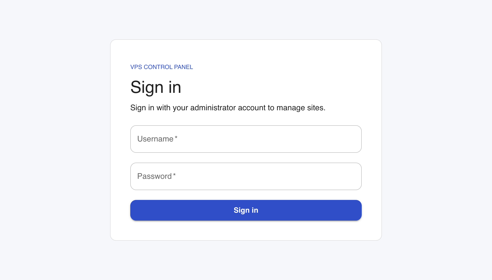
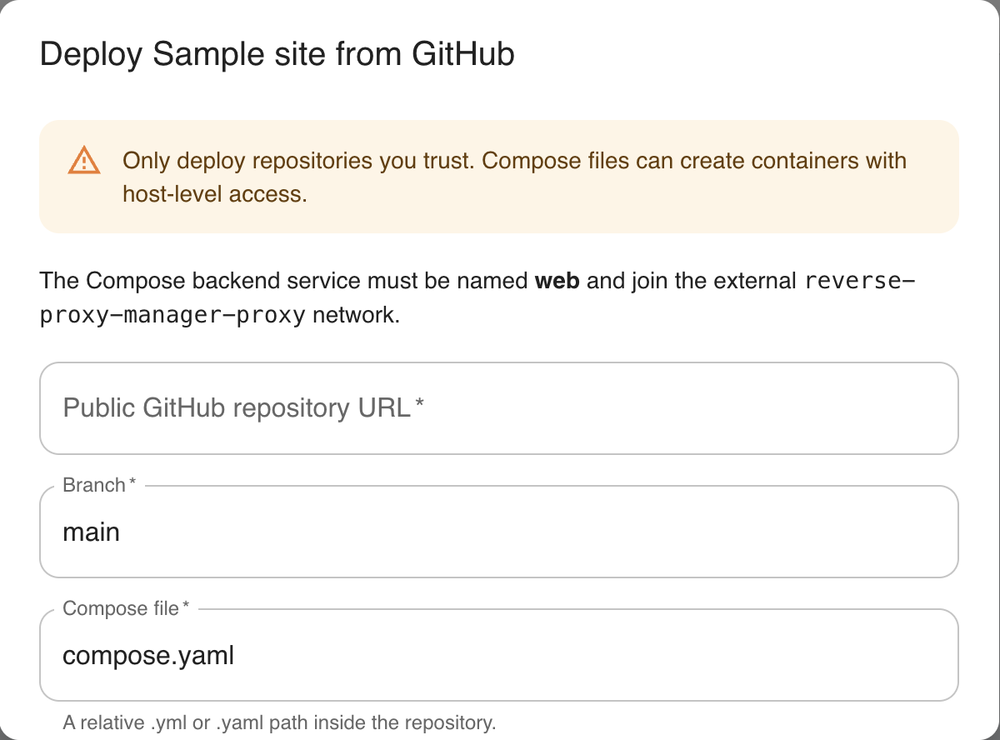

# Reverse Proxy Manager

A Node.js application for managing public site routes and Compose deployments
on a VPS. Administrators use the web dashboard to configure routes, manage
their backends, and deploy from public GitHub repositories.

## Requirements

- Node.js 20.19 or newer
- npm
- GNU Make (for the convenience commands below)
- Docker and Docker Compose (for container use)

## Local development

```sh
npm install
npm run dev:api
```

In another terminal, start the web development server:

```sh
npm run dev:web
```

The API listens on port `3000` by default. The Vite server proxies API requests
to it and serves the web interface on `http://127.0.0.1:5173`. Set `PORT` to
change the API port. `GET /health` returns `{"status":"ok"}` when the process
is responding.

Run the test suite with:

```sh
npm test
```

The automated tests cover administrator setup and authentication, site
validation and route generation, and GitHub deployment queue/worker behavior.

Build the production web assets with:

```sh
npm run build
```

The frontend currently ships in English. Edit the [English message catalog](./client/src/messages.js)
to change UI wording, and keep named placeholders intact when translating
messages. Messages returned by the server are outside the frontend catalog.

The [app shell](./client/src/App.jsx) handles the session and switches between
[sign-in](./client/src/features/auth/LoginView.jsx) and the
[sites dashboard](./client/src/features/sites/SitesDashboard.jsx). The dashboard
owns site and deployment requests; its list, cards, and dialogs receive data and
callbacks through props.

## Create the initial administrator

Set `DATABASE_PATH` if the database should not use the default
`./data/app.sqlite`. Provide `ADMIN_USERNAME` and `ADMIN_PASSWORD` through a
local secret manager or another private environment mechanism, then run:

```sh
npm run admin:create
```

The username must be 3-64 characters and use letters, numbers, `.`, `_`, or
`-`. Passwords must be at least 12 characters. Avoid putting the password
directly in shell commands or source-controlled files.

## Use the web dashboard

Start the application using [Local development](#local-development) or
[Container](#container), then open the manager URL and sign in with the
administrator account created above.



### Add and manage a site

1. Select **Add site**.
2. Enter a name, the public domain or IP address, the backend's Docker Compose
   service name, and the port the application listens on inside its container.
3. Select **Create site**. New sites are enabled by default and their route is
   published immediately.

The backend service must be reachable on the `reverse-proxy-manager-proxy`
Docker network. Domain routes use HTTPS with Let's Encrypt; IP-address routes
use HTTP only. For domain routes, point public DNS at the VPS and allow inbound
ports 80 and 443.

Each site card shows its public host, backend, and whether its route is enabled.
Use the **Route** switch to enable or disable routing, the edit button to change
the site settings, and the delete button to remove the site and its route.
Deleting a site cannot be undone. While a deployment is queued or running, the
site's route and edit/delete/deploy controls are unavailable. Select **Sign
out** in the header to end the administrator session.

### Deploy from GitHub

Select **Deploy** on a site card, then provide a public GitHub repository URL,
branch, and path to a `.yml` or `.yaml` Compose file in that repository. The
defaults are `main` and `compose.yaml`. The Compose service name must exactly
match the site's backend service name and join the external proxy network
described in [GitHub Compose deployments](#github-compose-deployments).

Select **Queue deployment** to start the job. The site's latest deployment
status appears on its card (`queued`, `running`, `succeeded`, or `failed`); a
failure message is shown there when available. Only one deployment per site
can be active at a time.



Deploy only repositories you trust: Compose files can request host mounts,
privileged containers, and other powerful capabilities. Private GitHub
repositories are not supported.

## Authentication API

- `POST /api/auth/login` accepts a JSON `username` and `password`, and sets an
  HTTP-only, same-site session cookie on success.
- `GET /api/auth/me` returns the authenticated administrator.
- `POST /api/auth/logout` revokes the current session.

Login failures are rate-limited. Sessions expire after 12 hours and are stored
as hashes in SQLite. The cookie is marked `Secure` when `NODE_ENV=production`.

## Site management API

Site management requires an authenticated administrator:

- `GET /api/sites` lists configured sites.
- `POST /api/sites` creates a site.
- `PUT /api/sites/:id` replaces a site's configuration.
- `DELETE /api/sites/:id` removes a site.

A site uses `name`, `host`, `backendService`, and `backendPort`; `enabled` is
optional when creating a site. `host` must be a fully qualified domain name or
an IP address. Domain sites use HTTP-to-HTTPS redirection and Let's Encrypt;
IP sites use HTTP only. Backends must be reachable by their Docker service name
on the `reverse-proxy-manager-proxy` network.

The manager writes Traefik's watched file-provider configuration atomically.
Upstream 5xx errors are served a static fallback page. Application containers
must join the proxy network, for example by declaring it as an external network
in their Compose file.

## GitHub Compose deployments

From a site's **Deploy** action, an administrator can queue a deployment from a
public GitHub repository, branch, and Compose YAML file. The Compose service
named by the site's backend must join the external proxy network:

```yaml
services:
  web:
    build: .
    networks:
      - proxy

networks:
  proxy:
    external: true
    name: reverse-proxy-manager-proxy
```

The manager API writes a job to a separate SQLite queue. A dedicated worker
clones the repository and runs `docker compose up --detach --build
--remove-orphans` with a site-specific project name. Job status is visible in
the UI. Deployments are limited to public GitHub URLs; private repository
credentials are not supported.

The worker alone receives the Docker socket. Because a Compose file can request
host mounts, privileged containers, or other powerful capabilities, deploy
only code you trust. The web application itself does not receive Docker socket
access.

## Container

Copy `.env.example` to `.env` and replace its example values. Set `ACME_EMAIL`
to a valid contact email before starting Compose. Public DNS for each domain
must point to the VPS, and
ports 80 and 443 must be reachable from the internet for routing and
certificate issuance. Set `ADMIN_HOST` to a domain for HTTPS access to the
manager UI; leave it unset to use an SSH tunnel to the loopback-bound API port.

Build and start the services in the background with:

```sh
make run
```

Stop the containers with `make stop`; named volumes are preserved. Run the
test suite with `make test`.

Create an administrator in the Compose database by exporting `ADMIN_USERNAME`
and `ADMIN_PASSWORD` through a private environment mechanism and running:

```sh
docker compose run --rm -e ADMIN_USERNAME -e ADMIN_PASSWORD app npm run admin:create
```

The health endpoint is available at `http://localhost:3000/health`. When
`ADMIN_HOST` is configured, the manager UI is routed through Traefik with
HTTPS. Otherwise, use an SSH tunnel to access the loopback-bound API and UI.
The SQLite database, Traefik certificates, and generated proxy routes are
stored in named volumes. Deployment queue records and checked-out repositories
use separate volumes.
